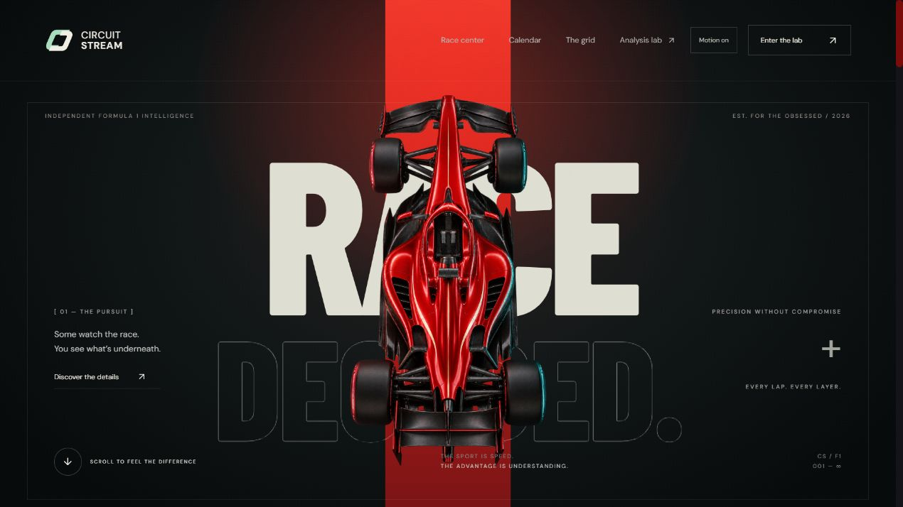
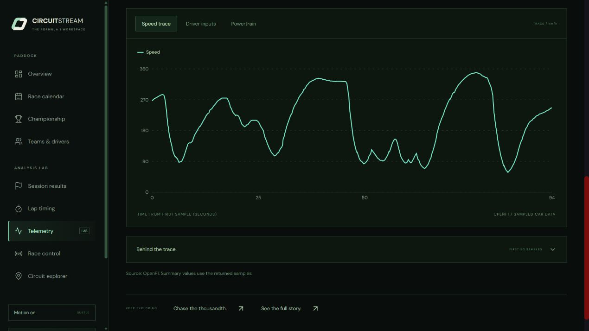
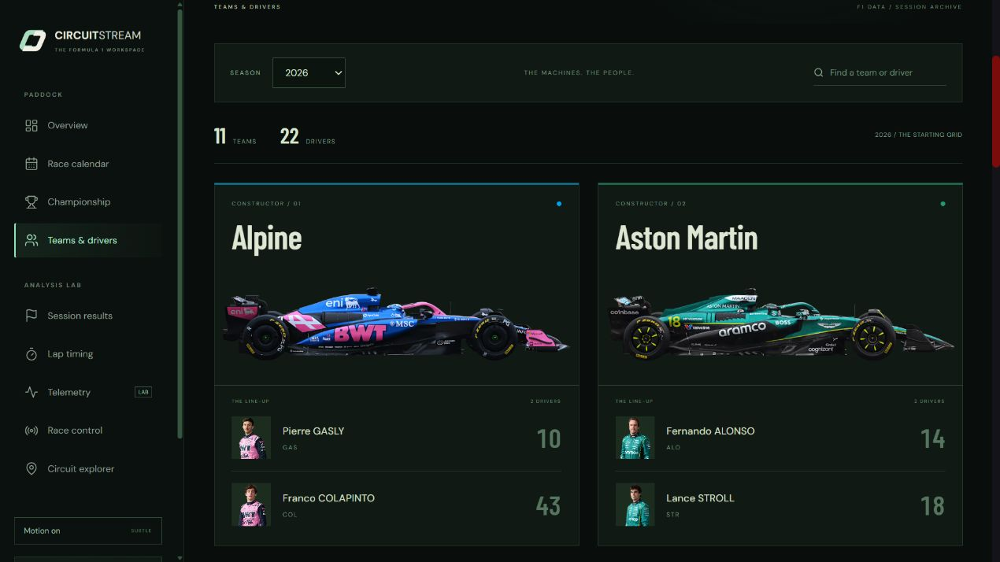
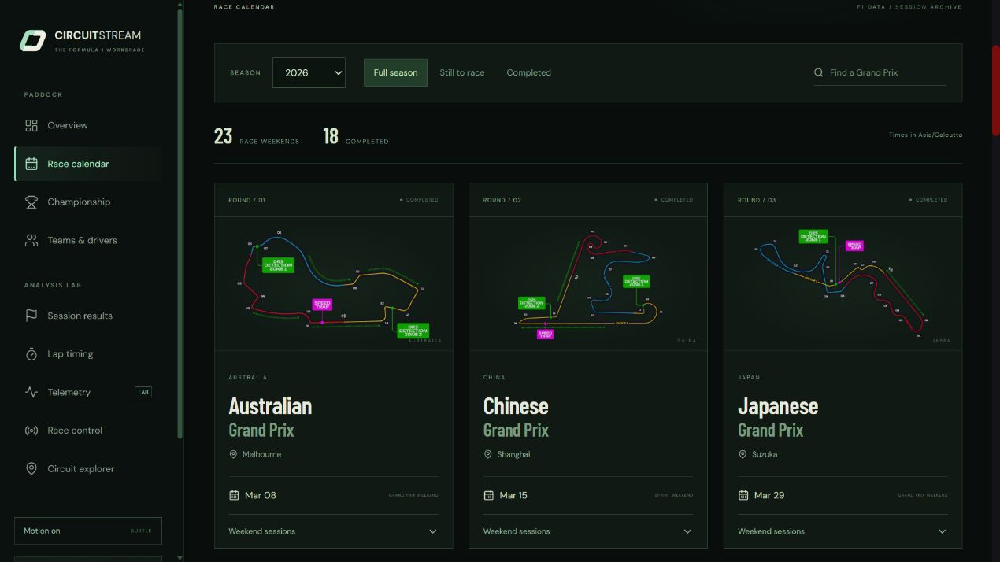
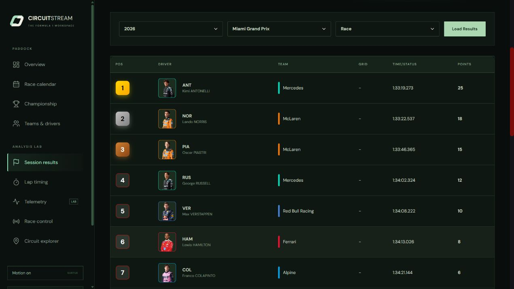
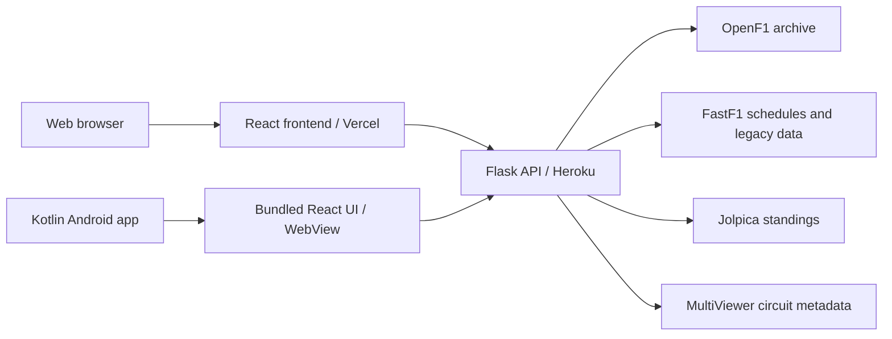

<div align="center">
  
  <h1>Circuit Stream</h1>
  <p><strong>Every lap. Every layer.</strong></p>
  <p>An independent Formula 1 analysis workspace for the web and Android.</p>
  <p>
    <a href="https://circuit-stream-f1-data-analysis.vercel.app/">Open web app</a> ·
    <a href="https://github.com/AdithyaSM31/Circuit-Stream---F1-Data-Analysis/releases/tag/v2.0.0">Android v2.0.0</a> ·
    <a href="https://circuit-stream-f1-data-analysis.vercel.app/brand/">Brand &amp; logo assets</a>
  </p>
  <p>
    
    
    
    
  </p>
</div>



Circuit Stream turns race-weekend data into interactive telemetry charts, lap timing, classifications, and circuit insights. A cinematic homepage leads into a consistent racing-green workspace, with responsive layouts, scroll-driven parallax, and a persistent Motion switch.

## What's new in v2.0.0

- **Kotlin Android app:** replaced Capacitor with a Kotlin container using Android WebView. The existing responsive React interface is bundled inside the APK.
- **New identity:** an interlocking circuit logo, wordmark, launcher icon, favicon, and branded Android splash screen.
- **Unified interface:** redesigned calendar, championship, teams and drivers, and every analysis view.
- **Restored analysis data:** archive-backed telemetry, results, lap timing, and race control for sessions from 2023 onward; circuit metadata loads independently of the timing feed.
- **Accurate session rosters:** driver selections resolve the actual number and identity used in that session.
- **Mobile refinements:** corrected driver portrait crops, Android safe-area spacing, header search-button alignment, and 44px mobile header touch targets.
- **Lighter rendering:** reduced blur effects, visibility-aware animation work, and reduced-motion support.

## Screenshots

These screenshots show the live web interface. The Android app bundles the same responsive layout.

<table>
  <tr>
    <td width="50%"><strong>Telemetry analysis</strong><br /></td>
    <td width="50%"><strong>Teams &amp; drivers</strong><br /></td>
  </tr>
  <tr>
    <td width="50%"><strong>Race calendar</strong><br /></td>
    <td width="50%"><strong>Session results</strong><br /></td>
  </tr>
</table>

## Explore the workspace

| View | What you can explore |
| --- | --- |
| **Overview** | Cinematic racing visuals, weekend agenda, season progress, and upcoming races. |
| **Race calendar** | Season schedule, circuit images, race filters, and local session times. |
| **Championship** | Driver and constructor standings. |
| **Teams & drivers** | Searchable teams, cars, session-backed rosters, and driver portraits. |
| **Telemetry** | Speed, RPM, gears, throttle, brake, and DRS for a selected driver and lap; summary metrics and raw samples. |
| **Session results** | Race, qualifying, sprint, and practice classifications, with points and grid positions when published. |
| **Lap timing** | Lap and sector times, compounds, stints, and tyre age when available; pagination through the complete returned lap set. |
| **Race control** | Archived flags, safety-car messages, investigations, and other session announcements. |
| **Circuit explorer** | Event location, circuit layout, and published corner metadata. |

## Android app

**[Download CircuitStream-v2.0.0.apk](https://github.com/AdithyaSM31/Circuit-Stream---F1-Data-Analysis/releases/download/v2.0.0/CircuitStream-v2.0.0.apk)** · [Release notes and checksum](https://github.com/AdithyaSM31/Circuit-Stream---F1-Data-Analysis/releases/tag/v2.0.0)

| Detail | v2.0.0 |
| --- | --- |
| Application ID | `com.circuitstream.f1` |
| Version name / code | `2.0.0` / `20001` |
| Minimum Android | Android 6.0 / API 23 |
| Compile / target SDK | 35 |
| Android implementation | Kotlin + Android WebView; no Capacitor |
| Interface | Bundled React assets, served through AndroidX WebViewAssetLoader |

Kotlin handles splash, system insets, native back navigation, Activity lifecycle, loading errors, and external links. The interface opens from packaged assets; race data still requires internet access.

The published APK is **debug-signed for direct installation and testing**. It cannot update an installation signed with a different key. Signing a production upgrade requires the original release key. See the [Android build and signing guide](frontend/android/README.md).

## Architecture and data



| Layer | Technology |
| --- | --- |
| Web interface | React 18, React Router, Recharts, Lucide, custom CSS |
| Android | Kotlin 2.1.21, AndroidX WebKit, AndroidX SplashScreen |
| Backend | Flask, FastF1, pandas, NumPy, requests, Gunicorn |
| Hosting | Vercel frontend; Heroku backend |
| Caching | FastF1 disk cache, bounded archive-response cache, Axios response caching |

**Availability:** this is primarily a historical/session-archive analysis app, not a guaranteed live timing service. OpenF1-backed session tools cover 2023 onward when data has been published. Telemetry is requested after the session has finished. Earlier seasons use FastF1 where supported; completeness varies by event, session, driver, and channel. Missing fields stay unavailable rather than being fabricated. Public providers can impose rate limits or temporary outages.

## Run locally

### Requirements

- **Node.js 22** and npm.
- **Python 3.11+** and a virtual environment.
- For Android builds: **JDK 17**, Android SDK Platform 35, and Android Build Tools 35.0.0.

### Backend

From the repository root:

```sh
python -m venv venv
```

Activate the environment:

```powershell
# Windows PowerShell
.\venv\Scripts\Activate.ps1
```

```sh
# macOS / Linux
source venv/bin/activate
```

Then install and run:

```sh
pip install -r requirements.txt
python app.py
```

The API runs at `http://localhost:5000`. FastF1 stores downloaded data in `cache/`.

### Frontend

In a second terminal:

```sh
cd frontend
npm ci
npm start
```

Open `http://localhost:3000`. Localhost defaults to the local Flask API. Set `REACT_APP_API_URL` in `frontend/.env.local` to use a different backend; this file is ignored by Git.

```dotenv
REACT_APP_API_URL=http://localhost:5000
```

### Production web build

```sh
cd frontend
npm run build
```

The build runs ESLint before creating `frontend/build/`. Configure `REACT_APP_API_URL` to the HTTPS backend when deploying the frontend separately from Flask. The existing deployment uses Vercel for the web interface and Heroku for the API.

### Android build

Set `JAVA_HOME` and `ANDROID_HOME` for your machine, then run from `frontend`:

```sh
npm ci
npm run android:debug
```

The prepare step builds and bundles the mobile interface with the production HTTPS backend. The APK is generated at `frontend/android/app/build/outputs/apk/debug/app-debug.apk`. Override the backend with `CIRCUIT_STREAM_API_URL` if needed.

For release APK/AAB builds and signing configuration, follow the [Android README](frontend/android/README.md).

## Validation

Backend regression tests, from the repository root:

```sh
python -m unittest discover -s tests -v
```

Frontend tests, from `frontend`:

```sh
npm test -- --watchAll=false --runInBand
```

Kotlin unit tests and Android lint, after `npm run android:prepare`:

```sh
cd android
./gradlew testDebugUnitTest lintDebug
```

Use `gradlew.bat` on Windows. Optional device smoke tests use `connectedDebugAndroidTest` with a connected emulator or phone. The v2.0.0 APK passed build, lint, signature checks, 2 Kotlin unit tests, and 14 frontend tests; device testing is separate.

## API overview

| Endpoint | Purpose |
| --- | --- |
| `GET /api/health` | Backend health |
| `GET /api/schedule/<year>` | Season calendar |
| `GET /api/event/<year>/<round>` | Event metadata |
| `GET /api/current-event` | Current/upcoming weekend |
| `GET /api/drivers/<year>/<round>/<session_type>` | Actual session roster |
| `GET /api/session/<year>/<round>/<session_type>` | Classifications |
| `GET /api/laps/<year>/<round>/<session_type>?driver=VER` | Lap timing; driver filter is optional |
| `GET /api/telemetry/<year>/<round>/<session_type>/<driver>/<lap>?driver_code=VER` | Lap-bounded telemetry with session driver identity |
| `GET /api/race-control/<year>/<round>/<session_type>` | Race-control archive |
| `GET /api/circuit/<year>/<round>` | Circuit metadata |
| `GET /api/standings/drivers/<year>` | Driver championship |
| `GET /api/standings/constructors/<year>` | Constructor championship |

Common session codes: `R` (race), `Q` (qualifying), `S` (sprint), `FP1`, `FP2`, and `FP3` (practice).

## Project structure

```text
app.py                         Flask API and routing
archive_service.py             Results, laps, race control, and circuit metadata
telemetry_service.py           Historical telemetry and session driver identities
frontend/src/                  Shared responsive React interface
frontend/public/brand/         SVG logo, wordmark, app icon, and brand page
frontend/android/              Kotlin Android project
frontend/scripts/              Android asset preparation and build helpers
docs/images/                   README screenshots
tests/                         Backend regression tests
```

## Credits

Built by [Adithya SM](https://github.com/AdithyaSM31).

Data and tooling: [FastF1](https://docs.fastf1.dev/), [OpenF1](https://openf1.org/), [Jolpica F1](https://github.com/jolpica/jolpica-f1), and [MultiViewer](https://multiviewer.app/).

Circuit Stream is an independent project and is not affiliated with Formula 1, the FIA, or any team. Data and imagery remain subject to their respective owners' terms.
